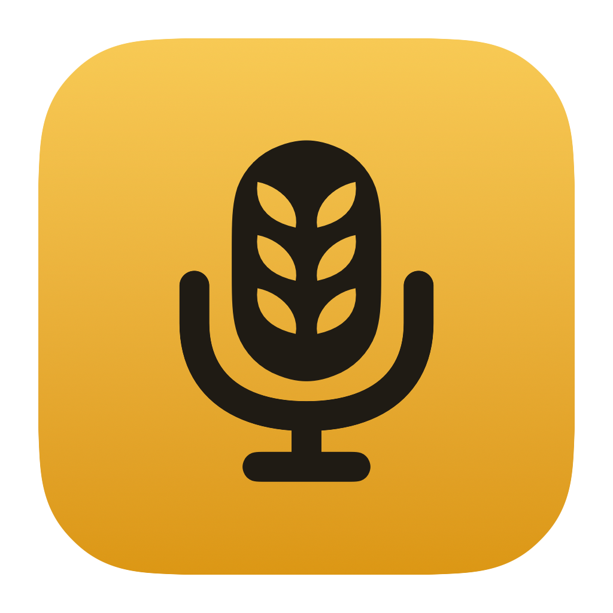
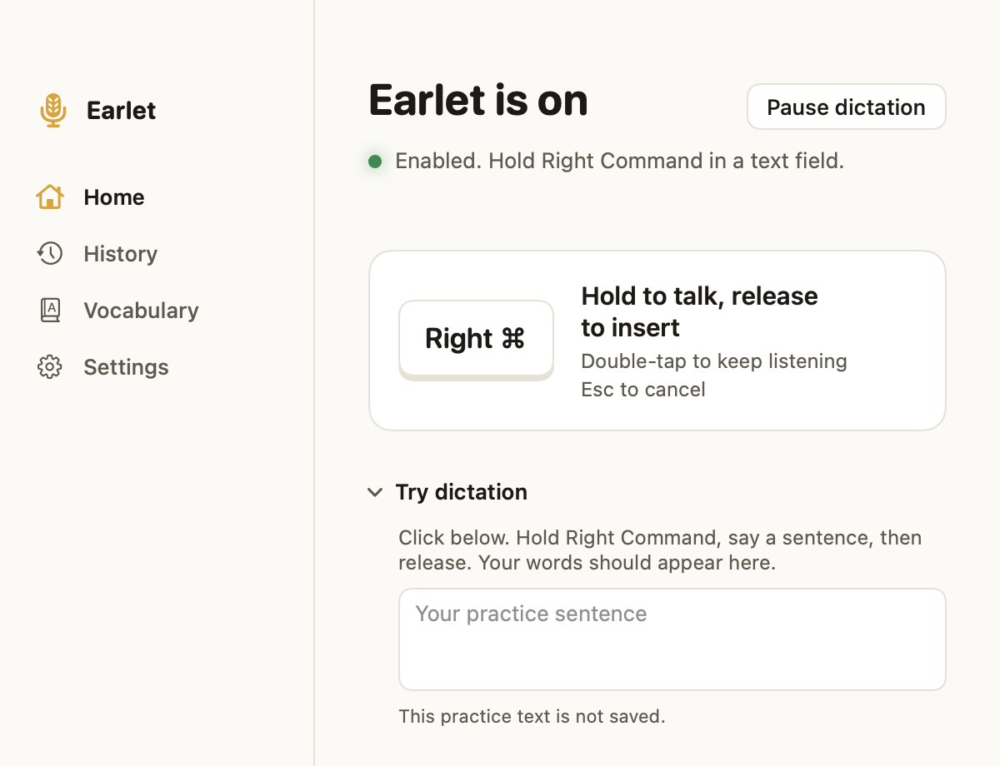

<p align="center">
  
</p>

<h1 align="center">Earlet</h1>

<p align="center">
  <strong>Your voice, right where you type.</strong><br>
  Native on Mac. Local speech recognition. No account required.
</p>

<p align="center">
  <a href="#quick-start"><strong>Try the source preview →</strong></a>
  &nbsp; · &nbsp;
  <a href="SUPPORT.md">Get help</a>
</p>

<p align="center">
  <sub>macOS 14+ · Apple Silicon · 0.1.0 source preview<br>
  Build from source. No downloadable release yet.</sub>
</p>

<p align="center">
  <picture>
    <source media="(prefers-color-scheme: dark)" srcset="docs/assets/mac-window-dark.png">
    
  </picture>
</p>

<p align="center">
  <kbd>Right ⌘</kbd> &nbsp; Hold. Speak. Release to insert.<br>
  <sub>Native interface detail with fixture state. <a href="docs/readme-media.md">How it was made</a>.</sub>
</p>

<a name="start-here"></a>

<details>
<summary>Contents</summary>

- [What it does](#what-it-does)
- [Platforms](#platforms)
- [Quick start](#quick-start)
- [Your first dictation](#your-first-dictation)
- [Privacy and local data](#privacy-and-local-data)
- [Known limitations](#known-limitations)
- [Community](#community)
- [Build a package](#build-a-package)
- [Repository map](#repository-map)
- [Documentation map](#documentation-map)
- [Contributing and licensing](#contributing-and-licensing)

</details>

## What it does

### Stay in your flow

Write a message, a note, or a longer draft in the app you're already using.
Hold a key to speak; release to insert at your cursor. Double-tap for
hands-free dictation, with a ten-minute recording limit on the Mac.
The floating indicator shows microphone levels and a live text preview.

### Make room for your words

Teach names, specialist terms, and preferred spellings. Inspect learned
vocabulary and undo changes. Choose a language or let the model detect it;
recognition quality depends on your model, voice, and recording conditions.
Automatic correction capture depends on the destination app.

### Pick up where you left off

If a paste fails, use **Copy last text**. Recover the last failed or interrupted
recording when one is available.
On the Mac, search encrypted **History**, copy earlier text, or play a kept
recording. Retention and deletion stay under your control.

## Platforms

| Platform | Availability |
| --- | --- |
| **macOS 14+ · Apple Silicon** | Source preview. Native SwiftUI app with MLX recognition. Supply a Python runtime and model. |
| Windows x64 | WPF source and tests. Cross-built; not exercised on Windows hardware. Binary releases deferred. |
| Windows ARM64 | App-only build target; no complete speech package. |
| Intel Mac, Linux, Android, iOS | No supported app. Mobile is adapter research only. |

## Quick start

This path is for an **Apple Silicon Mac with macOS 14+, Swift 6.2+, and
Python 3.11**. It starts a development build, not an installed release.
Download or clone this repository, open a terminal in its root, and close
any installed copy of Earlet or the earlier Dictation preview first: the development build shares its
settings and vocabulary.

### 1. Prepare the runtime

```bash
python3.11 -m venv .venv
source .venv/bin/activate
python -m pip install -r runtime/requirements-macos.txt
export TMPDIR=/tmp
```

### 2. Add a speech model

This example uses
[MLX Whisper Large v3 Turbo, 4-bit](https://huggingface.co/mlx-community/whisper-large-v3-turbo-4bit),
about 464 MB of model files. The `hf` command comes with the dependencies
above. It downloads from Hugging Face into the repository's ignored model
directory; weights are not included in the source preview.

```bash
hf download mlx-community/whisper-large-v3-turbo-4bit \
  --revision 0f058d38170d183f9fdee07908f5b515d91793a8 \
  --local-dir runtime/models/whisper-large-v3-turbo-4bit
```

You can instead use an existing [MLX Whisper model](docs/development.md#model-formats)
and set `DICTATION_MODEL_DIR` below to its absolute path. Windows CTranslate2
model folders are not interchangeable with MLX models.

### 3. Launch Earlet

Run this in the same terminal, with the virtual environment still active:

```bash
DICTATION_PYTHON="$PWD/.venv/bin/python" \
DICTATION_RUNTIME="$PWD/runtime" \
DICTATION_MODEL_DIR="$PWD/runtime/models/whisper-large-v3-turbo-4bit" \
swift run --package-path macos --jobs 4 Dictation
```

For toolchain setup and other build paths, see the
[development guide](docs/development.md#prerequisites). To run automated
checks, follow [Build and test](CONTRIBUTING.md#build-and-test).

## Your first dictation

1. Open the Mac app and follow its setup prompts. The full workflow needs
   **Microphone**, **Accessibility**, and **Input Monitoring** access. Quit and
   reopen the app after granting Input Monitoring.
2. In Home, click the **Try dictation** practice field. Hold **Right Command**,
   say a short sentence, then release. Wait for the transcription to finish.
   Practice text is not saved to History.
3. Try the same steps in a text field in another app. If the words do not
   appear, use **Copy last text** and paste them yourself.
4. In Settings, choose your hold key and language, and review History retention.
   Double-tap the hold key when you want to keep speaking hands-free.

If setup gets stuck, start with [Common setup problems](SUPPORT.md#common-setup-problems).
Password fields and Secure Input are intentionally protected. Support varies
by destination app; a successful paste does not prove that later corrections
can be read for learning.

## Privacy and local data

No account is required, and logs do not contain dictated words. Speech
recognition uses a local model. Logs can identify the destination app; review
them before sharing. **Copy last text** holds the latest usable result in memory.

- **Mac History.** Delivered words and kept recordings are encrypted with AES-256-GCM and a key in the login keychain. By default, words are kept forever and recordings for 30 days. Change retention or turn History off in Settings; Delete All History destroys its key.
- **Recovery audio.** The Mac writes an **unencrypted** temporary audio file while recording. A successful delivery, usable text/clipboard fallback, or cancellation removes it; at most one failed or interrupted take remains for up to seven days.
- **Vocabulary.** `learning.json` keeps vocabulary and correction evidence in **plain text**. Disable learning or inspect and remove learned words in the app.

Mac History lives under
`~/Library/Application Support/Dictation/dictation/history`; recovery audio
lives in the adjacent `recovery` directory. Password-field/Secure Input refusals
and dictations into the app's own practice field are not saved to History.
Windows has no transcript history; its recovery behavior is documented in
[the Windows guide](docs/design-windows.md#long-takes-are-never-lost).

Read the [security and storage policy](SECURITY.md#scope) and
[learning privacy rules](LEARNING.md#7-observers-and-privacy) before using
sensitive material. Report security concerns [privately](SECURITY.md).

## Known limitations

- Correction capture depends on the destination application's accessibility
  support. A successful paste does not guarantee that later edits can be read.
- An intermittent report of repeated letters in pasted text remains under
  investigation and has not been conclusively attributed.
- Long dictation can consume substantial compute. Sustained power,
  temperature, and voice-accuracy measurements are incomplete.
- Clean-machine installation and the full range of microphone routes, hotkeys,
  and destination apps are not yet validated.
- Windows and mobile support have the limits listed [above](#platforms).

Automated checks do not establish microphone quality or recognition accuracy on
your voice. For a reproducible report, include the build, OS, approximate time,
steps, and destination app, without private dictated text or recordings.
[SUPPORT.md](SUPPORT.md) explains the diagnostic files and reporting channels.

## Community

Start with [Q&A](https://github.com/scamai/earlet/discussions/categories/q-a)
for setup and usage, or share a workflow in
[Ideas](https://github.com/scamai/earlet/discussions/categories/ideas).
For a reproducible failure, use the [reporting guide](SUPPORT.md#where-to-go).
Keep private dictations, recordings, and vocabulary out of posts.

**A useful first contribution:** try one setup step, identify what was confusing,
and propose clearer wording with the command or link you checked.
[Contribution guide →](CONTRIBUTING.md#your-first-contribution)

Follow the [roadmap](ROADMAP.md), [changelog](CHANGELOG.md), and
[announcements](https://github.com/scamai/earlet/discussions/categories/announcements).
Support is best-effort, with no guaranteed response time. Participation follows
the [Code of Conduct](CODE_OF_CONDUCT.md).

## Build a package

<details>
<summary>For developers: create an app bundle</summary>

Packaging is a developer workflow. An app-only package has no Python runtime
or model and **cannot recognize speech**:

```bash
python3 tools/package.py --platform macos --app-only --output dist/macos-app
```

For a complete package, supply a relocatable Python distribution with the
worker dependencies and your model using the
[packaging guide](docs/development.md#packaging). Public signing, Hardened
Runtime, notarization, and clean-machine installation remain separate work.

</details>

## Repository map

```text
macos/     SwiftUI app and local recognition
windows/   WPF app and Windows-focused tests
runtime/   Speech dependencies and ignored model folders
tools/     Builds, packaging, tests, media capture
tests/     Boundary and cross-platform checks
docs/      Development, design, and acceptance guides
```

## Documentation map

[Development & packaging](docs/development.md) ·
[Architecture](docs/architecture.md) · [Support](SUPPORT.md)

<details>
<summary>Design, data, testing, and other guides</summary>

- **Interface:** [Shared behavior](DESIGN.md),
  [Mac](docs/design-macos.md), [Windows](docs/design-windows.md),
  [Earlet identity](docs/brand.md).
- **Data:** [Learning rules](LEARNING.md), [Security & storage](SECURITY.md).
- **Verification:** [Installed Mac acceptance](docs/acceptance.md),
  [README media](docs/readme-media.md).
- **Project:** [Contributing](CONTRIBUTING.md), [Changelog](CHANGELOG.md),
  [Roadmap](ROADMAP.md), [Mobile research](mobile/README.md).

</details>

## Contributing and licensing

[Contributions](CONTRIBUTING.md) follow the documented tests and sign-off
requirements. [Automated checks](https://github.com/scamai/earlet/actions/workflows/ci.yml)
run on GitHub. Report security problems [privately](SECURITY.md).

Apache License 2.0. See [LICENSE](LICENSE), [NOTICE](NOTICE), and
[REUSE.toml](REUSE.toml) for terms and third-party notices.
